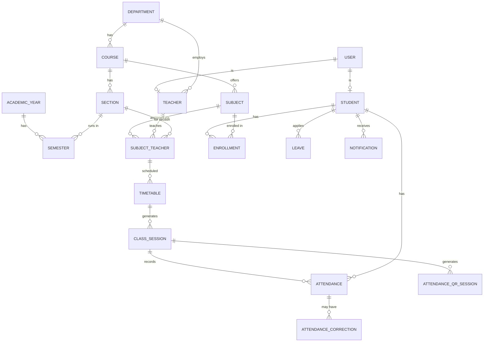

# DATABASE.md — Schema (v2 — session-based, audited)

> Revision note: v1 tracked attendance by `student_id + subject_id + date`, which breaks for multi-period days, lab/tutorial sessions, and re-scheduled classes. v2 introduces `ClassSession` as the anchor for every attendance record. See "Migration notes" at the bottom.

## Core relationships


## Tables

### User (central auth — new)
| Column | Type | Notes |
|---|---|---|
| user_id | UUID/PK | |
| name | text | |
| email | text | unique |
| password_hash | text | bcrypt/argon2 — never plaintext |
| role | enum | SUPER_ADMIN / ADMIN / HOD / TEACHER / STUDENT |
| is_active | boolean | soft-disable instead of delete |
| last_login_at | timestamp | nullable |
| created_at / updated_at | timestamp | |

### Department (new)
| Column | Type | Notes |
|---|---|---|
| department_id | UUID/PK | |
| name | text | |
| code | text | unique |
| hod_id | FK → Teacher | nullable |
| created_at / updated_at | timestamp | |

### AcademicYear (new)
| Column | Type | Notes |
|---|---|---|
| academic_year_id | UUID/PK | |
| name | text | e.g. "2026-27" |
| start_date / end_date | date | |
| is_current | boolean | |

### Semester (new)
| Column | Type | Notes |
|---|---|---|
| semester_id | UUID/PK | |
| academic_year_id | FK → AcademicYear | |
| semester_number | int | |
| start_date / end_date | date | |
| is_active | boolean | |

### Course
| Column | Type | Notes |
|---|---|---|
| course_id | UUID/PK | |
| course_name | text | |
| course_code | text | unique |
| department_id | FK → Department | |
| duration_years | int | |
| created_at / updated_at | timestamp | |

### Section
| Column | Type | Notes |
|---|---|---|
| section_id | UUID/PK | |
| section_name | text | e.g. "CS-A" |
| course_id | FK → Course | |
| semester_id | FK → Semester | |
| created_at / updated_at | timestamp | |

### Subject (teacher removed — see SubjectTeacher)
| Column | Type | Notes |
|---|---|---|
| subject_id | UUID/PK | |
| subject_code | text | unique |
| subject_name | text | |
| course_id | FK → Course | |
| semester_id | FK → Semester | |
| credits | int | |
| type | enum | theory / lab / tutorial |
| created_at / updated_at | timestamp | |

### SubjectTeacher (new — join table)
| Column | Type | Notes |
|---|---|---|
| id | UUID/PK | |
| subject_id | FK → Subject | |
| teacher_id | FK → Teacher | |
| section_id | FK → Section | same subject can have different teachers per section |
| created_at | timestamp | |
| **unique** | | (subject_id, section_id) — one teacher per subject per section at a time |

### Student
| Column | Type | Notes |
|---|---|---|
| student_id | UUID/PK | |
| user_id | FK → User | unique — auth lives on User now |
| name | text | |
| roll_no | text | unique |
| email | text | unique |
| phone | text | |
| course_id | FK → Course | current course |
| section_id | FK → Section | current section |
| parent_email | text | |
| parent_phone | text | |
| created_at / updated_at | timestamp | |

### Teacher
| Column | Type | Notes |
|---|---|---|
| teacher_id | UUID/PK | |
| user_id | FK → User | unique |
| name | text | |
| employee_id | text | unique |
| department_id | FK → Department | |
| created_at / updated_at | timestamp | |

### Enrollment (new — replaces implicit "student takes all section subjects")
| Column | Type | Notes |
|---|---|---|
| enrollment_id | UUID/PK | |
| student_id | FK → Student | |
| subject_id | FK → Subject | |
| semester_id | FK → Semester | |
| section_id | FK → Section | |
| status | enum | active / dropped / completed |
| enrolled_at | timestamp | |
| created_at / updated_at | timestamp | |

Attendance eligibility and percentage are always computed against **active enrollment**, not just section membership — this correctly handles subject drops, section transfers, and historical semesters.

### Timetable
| Column | Type | Notes |
|---|---|---|
| timetable_id | UUID/PK | |
| subject_id | FK → Subject | |
| section_id | FK → Section | |
| teacher_id | FK → Teacher | |
| day_of_week | enum | Mon–Sat |
| start_time / end_time | time | |
| room_no | text | |
| session_type | enum | lecture / lab / tutorial |
| is_active | boolean | |
| created_at / updated_at | timestamp | |

Backend must reject overlapping timetable entries for the same **teacher**, **section**, or **room** unless explicitly flagged as allowed (e.g., co-taught lab).

### ClassSession (new — the critical fix)
| Column | Type | Notes |
|---|---|---|
| session_id | UUID/PK | |
| timetable_id | FK → Timetable | |
| subject_id | FK → Subject | |
| section_id | FK → Section | |
| teacher_id | FK → Teacher | |
| date | date | |
| start_time / end_time | time | |
| session_type | enum | lecture / lab / tutorial |
| status | enum | scheduled / open / submitted / locked / cancelled |
| created_at / updated_at | timestamp | |

One row is generated per actual occurrence of a timetable slot. This is what attendance actually attaches to — not a bare date.

### Attendance (now references session, not date)
| Column | Type | Notes |
|---|---|---|
| attendance_id | UUID/PK | |
| session_id | FK → ClassSession | |
| student_id | FK → Student | |
| status | enum | present / absent / late / excused / on_duty / medical |
| marked_by | FK → User | |
| method | enum | manual / QR |
| marked_at | timestamp | |
| device_id | text | nullable, for proxy-detection signal |
| remarks | text | nullable |
| created_at / updated_at | timestamp | |
| **unique** | | (session_id, student_id) — a student can only have one record per session |

### AttendanceCorrection (new)
| Column | Type | Notes |
|---|---|---|
| correction_id | UUID/PK | |
| attendance_id | FK → Attendance | |
| requested_by | FK → User | student or teacher |
| old_status | enum | |
| requested_status | enum | |
| reason | text | |
| document_url | text | nullable |
| status | enum | pending / approved / rejected |
| reviewed_by | FK → User | nullable, HOD/Admin |
| reviewed_at | timestamp | nullable |
| created_at / updated_at | timestamp | |

Approval writes an `AuditLog` entry automatically and updates the underlying `Attendance` row.

### AttendanceQRSession (new — QR security)
| Column | Type | Notes |
|---|---|---|
| qr_id | UUID/PK | |
| session_id | FK → ClassSession | |
| token_hash | text | never store the raw token |
| created_at | timestamp | |
| expires_at | timestamp | short-lived, ~5 min |
| revoked_at | timestamp | nullable, teacher can manually revoke |

The QR code itself only encodes a signed, opaque token — never raw session/student data.

### Leave
| Column | Type | Notes |
|---|---|---|
| leave_id | UUID/PK | |
| student_id | FK → Student | |
| from_date / to_date | date | |
| reason | text | |
| document_url | text | nullable |
| status | enum | pending / approved / rejected |
| approved_by | FK → User | nullable |
| approved_at | timestamp | nullable |
| rejection_reason | text | nullable |
| created_at / updated_at | timestamp | |

Backend validates date range validity and overlapping leave requests for the same student.

### Notification
| Column | Type | Notes |
|---|---|---|
| notification_id | UUID/PK | |
| student_id | FK → Student | |
| message | text | |
| type | enum | low_attendance / leave_status / correction_status / announcement |
| channel | enum | in_app / email / sms |
| status | enum | pending / sent / failed |
| sent_at | timestamp | nullable |
| read_at | timestamp | nullable |
| error_message | text | nullable |
| created_at | timestamp | |

### AuditLog
| Column | Type | Notes |
|---|---|---|
| log_id | UUID/PK | |
| table_name | text | |
| record_id | UUID | |
| action | enum | CREATE / UPDATE / DELETE / APPROVE / REJECT / LOCK |
| changed_by | FK → User | |
| changed_at | timestamp | |
| old_value | jsonb | |
| new_value | jsonb | |
| ip_address | text | nullable |
| user_agent | text | nullable |
| request_id | text | nullable, for tracing |

Audit logs are append-only — no update/delete endpoint exists for this table, by any role.

### Settings (new — no hardcoded thresholds)
| Column | Type | Notes |
|---|---|---|
| key | text/PK | e.g. `minimum_attendance_percentage` |
| value | text/jsonb | e.g. `"75"` |
| updated_by | FK → User | |
| updated_at | timestamp | |

Attendance-rule toggles (whether `late`/`on_duty` count as present, whether `medical`/`excused` are excluded from the denominator, whether low attendance blocks exam eligibility) also live here as configurable keys, not constants in code.

## Integrity architecture (root-of-trust, attestation, fairness)

> These tables implement the integrity architecture. See BACKEND.md "Integrity engine" and the AGENTS.md "Root of Trust" section. Design rule: attestation is a *signal*, not proof of identity; device capability is never an integrity judgment.

### Student — added column
| Column | Type | Notes |
|---|---|---|
| enrollment_trust_state | enum | `UNENROLLED` / `PENDING_SUPERVISED_ENROLLMENT` / `ACTIVE` / `REVOKED` / `REQUIRES_REENROLLMENT` — default `UNENROLLED`. A student not `ACTIVE` cannot use Mode B/C biometric verification. |

### BiometricEnrollment (new — explicit root-of-trust record, NOT a boolean on Student)
| Column | Type | Notes |
|---|---|---|
| enrollment_id | UUID/PK | |
| student_id | FK → Student | **unique** — one active enrollment per student |
| enrollment_method | enum | `SUPERVISED_STAFF` / `INSTITUTIONAL_ID_CARD` / `REGISTRATION_RECORD` / `TRUSTED_IDENTITY_SYSTEM` / `BIOMETRIC_ENROLLMENT_STATION` — configurable institutional anchor |
| enrolled_by | FK → User | the staff member who verified institutional identity |
| device_id | text | nullable — supports multiple biometric representations/devices |
| biometric_version | int | incremented on re-enrollment; do not assume one permanent template |
| status | enum | `active` / `revoked` / `replaced` |
| enrolled_at | timestamp | |
| revoked_at | timestamp | nullable |
| created_at / updated_at | timestamp | |

Store only the **minimum required metadata**. Do NOT store raw enrollment photographs unless the selected implementation requires it. Initial enrollment is a supervised, institution-approved event — an authenticated API call or remote selfie upload alone is never sufficient. Every enrollment writes an `AuditLog` with action `BIOMETRIC_ENROLLMENT` (revocation → `BIOMETRIC_REVOCATION`); normal students can never modify these audit records.

### DeviceIntegrityEvent (new — attestation telemetry; signals only)
| Column | Type | Notes |
|---|---|---|
| event_id | UUID/PK | |
| student_id | FK → Student | |
| device_id | text | |
| platform | text | e.g. android / ios |
| attestation_type | enum | `PLAY_INTEGRITY` / `APP_ATTEST` / `NONE` |
| result | enum | `passed` / `failed` / `unavailable` / `error` — `unavailable`/`error` are NOT failures of honesty |
| reason_code | text | nullable |
| session_id | text | nullable, links to the attendance attempt |
| created_at | timestamp | |

Only store what's needed to reason about attestation history; no unnecessary device telemetry.

### New enums
- `EnrollmentTrustState`, `BiometricEnrollmentStatus`, `EnrollmentMethod`, `AttestationResult`, `AttestationType`, `AttestationPolicy` (`ALLOW_WITH_LOWER_ASSURANCE` / `REQUIRE_ALTERNATIVE_VERIFICATION` / `TEACHER_REVIEW`), `AttendanceAssuranceMode` (`MODE_A` / `MODE_B` / `MODE_C`).
- `AuditAction` extended with `BIOMETRIC_ENROLLMENT`, `BIOMETRIC_REVOCATION`.

Device-tier **fairness** metrics (attestation availability/failure rates, face-verification failure, fallback frequency, teacher-review frequency, verification time, rejection rate, appeal rate — bucketed by device capability tier) are computed analytically in `deviceTier.service.ts`; they are a fairness instrument, not stored integrity judgments, and socioeconomic characteristics are never inferred from device type.

## Indexing
- `Attendance(session_id, student_id)` — unique + primary lookup
- `Attendance(student_id, session_id)` composite for history queries
- `ClassSession(section_id, date)`, `ClassSession(teacher_id, date)`
- `Enrollment(student_id, semester_id, status)`
- `Timetable(teacher_id, day_of_week)`, `Timetable(section_id, day_of_week)`, `Timetable(room_no, day_of_week)` — for conflict checks
- Unique indexes: `User.email`, `Student.roll_no`, `Teacher.employee_id`, `Department.code`, `Course.course_code`, `Subject.subject_code`

## Attendance percentage (computed, not stored)
```
eligible_sessions = sessions where status != 'cancelled'
                     AND student had active Enrollment at that date
counted_present    = sessions where status IN (rules-configured "counts as present")
percentage = counted_present / eligible_sessions * 100
```
Rules (present/late/absent/excused/on_duty/medical → counts or excluded) are read from `Settings`, not hardcoded — see BACKEND.md.

## Migration notes from v1 → v2
| v1 | v2 | Why |
|---|---|---|
| `Attendance(student_id, subject_id, date)` | `Attendance(session_id, student_id)` | supports multiple periods/day, labs, cancellations |
| `Subject.teacher_id` | `SubjectTeacher` join table | one subject, many teachers across sections |
| `Student.semester` (int) | `Enrollment.semester_id` via `Semester`/`AcademicYear` | historical semester accuracy |
| Credentials on `Student`/`Teacher` | Central `User` table | one auth system, one password policy |
| Free-text `department` | `Department` entity | referential integrity, HOD linkage |
| Hardcoded 75% threshold | `Settings.minimum_attendance_percentage` | configurable per institution |
